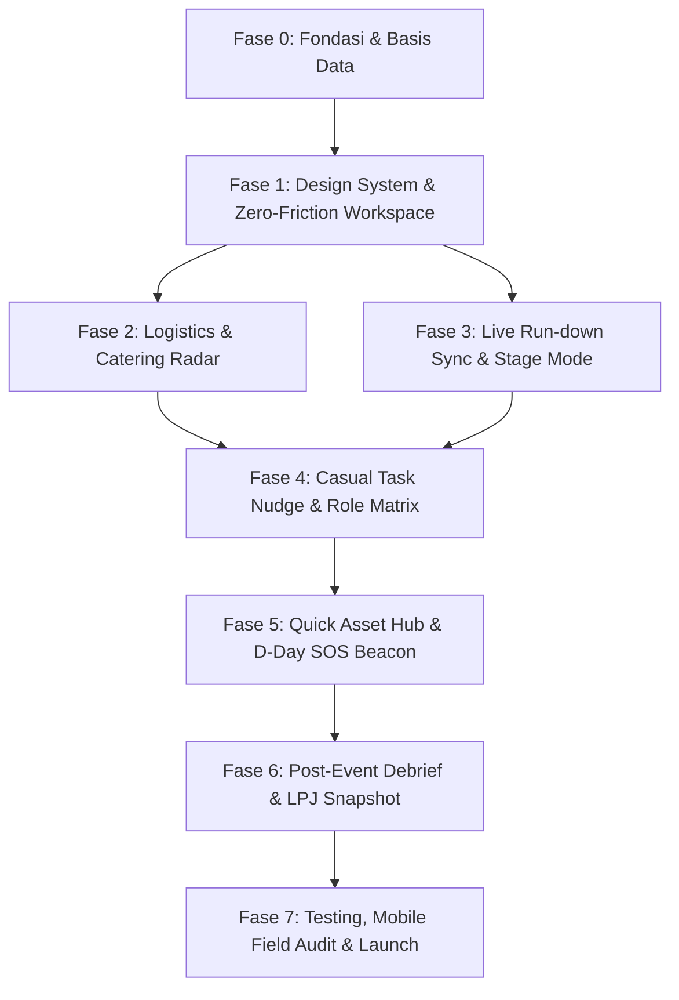

# Implementation Plan: Basecamp Lite

Dokumen ini adalah panduan teknis langkah-demi-langkah (*actionable implementation roadmap*) untuk membangun **Basecamp Lite** berdasarkan spesifikasi pada [PRD.md](file:///d:/basecamp-lite/PRD.md).

---

## 1. Ringkasan Eksekutif & Sasaran Teknis

* **Nama Produk:** Basecamp Lite
* **Core Philosophy:** *Zero Setup Friction* (< 90 detik buat event), *Context-Driven Clarity* (pemisahan logistik/rundown dari chat WA), dan *Casual Accountability* (Nudge santai tanpa rasa canggung).
* **Target Stack:**
  * **Framework:** Next.js 16.4 (App Router, Server Components & Server Actions)
  * **Runtime / Core:** React 19.3, TypeScript 5 (Strict Mode)
  * **Styling:** Tailwind CSS v4 dengan Custom Dark Glassmorphic Tokens
  * **State & Data Fetching:** Zustand (UI & local state), TanStack Query / Server Actions
  * **Database & ORM:** PostgreSQL (Supabase Hosted) via Prisma ORM
  * **Realtime & Storage:** Supabase Realtime (WebSocket pub/sub), Supabase Storage (bukti serah terima logistik)
  * **Icons & Animation:** Lucide React, Framer Motion

```
[Browser / Mobile PWA]
       │
       ├── (Server Components / Server Actions) ──► [Prisma ORM] ──► [PostgreSQL DB]
       │
       ├── (WebSocket Channel / Realtime Sub) ───► [Supabase Realtime] (Rundown, SOS, Nudges)
       │
       └── (Direct Client / API Route) ──────────► [Supabase Storage] (Handover Photos)
```

---

## 2. Struktur Direktori Proyek (Next.js 16 App Router)

```tree
d:/basecamp-lite/
├── app/
│   ├── (public)/
│   │   ├── e/
│   │   │   └── [slug]/
│   │   │       ├── page.tsx               # Public Hub View (Read-only rundown, info, maps)
│   │   │       └── layout.tsx
│   │   └── page.tsx                       # Landing Page & Quick Event Creation (< 90s)
│   ├── (organizer)/
│   │   └── workspace/
│   │       └── [slug]/
│   │           ├── layout.tsx             # Organizer Shell (Header, SOS Banner, Quick Tabs)
│   │           ├── page.tsx               # Dashboard / Bird-Eye Overview
│   │           ├── rundown/
│   │           │   └── page.tsx           # Live Run-down Sync & Stage Mode
│   │           ├── logistics/
│   │           │   └── page.tsx           # Gear & Catering Radar (3 tabs)
│   │           ├── tasks/
│   │           │   └── page.tsx           # Tasks & Casual Nudge Board
│   │           ├── assets/
│   │           │   └── page.tsx           # Quick Asset Hub & D-Day Wi-Fi Board
│   │           ├── members/
│   │           │   └── page.tsx           # Panitia & Division Matrix + WhatsApp Link
│   │           └── debrief/
│   │               └── page.tsx           # Post-Event LPJ & Debrief Snapshot
│   ├── api/
│   │   ├── events/route.ts                # Event creation & passcode verification
│   │   ├── realtime/auth/route.ts         # Token authorization for WebSocket channels
│   │   └── storage/upload/route.ts        # Presigned URL / direct photo proof upload
│   ├── globals.css                        # Tailwind v4 theme tokens & glassmorphic utilities
│   └── layout.tsx                         # Root layout with fonts & providers
├── components/
│   ├── ui/                                # Base Glassmorphic UI (Button, Input, Card, Modal, Badge)
│   ├── layout/                            # Navbar, Mobile Bottom Nav, EmergencyBanner
│   ├── event/                             # QuickCreateModal, PasscodeGateModal
│   ├── rundown/                           # NowPlayingBar, RundownTimeline, OvertimeRecalculator, CueSticky
│   ├── logistics/                         # LogisticsTabs, ItemCard, PhotoUploadModal, StatusSelector
│   ├── tasks/                             # TaskCard, NudgeModal, CooldownTimer
│   ├── assets/                            # AssetCard, WifiCredentialCard, ClipboardCopyButton
│   ├── members/                           # MemberCard, RoleBadge, DirectWhatsAppButton
│   └── debrief/                           # LPJReportView, ExportPdfButton
├── lib/
│   ├── db.ts                              # Prisma client singleton instance
│   ├── supabase/
│   │   ├── client.ts                      # Client-side Supabase Realtime & Storage client
│   │   └── server.ts                      # Server-side Supabase admin client
│   ├── store/
│   │   ├── use-event-store.ts             # Active event state (Zustand)
│   │   └── use-realtime-store.ts          # Connected channels & live alert subscriptions
│   ├── utils.ts                           # Tailwind merger (cn), date-fns formatters, overtime calculators
│   └── constants.ts                       # Division tags, nudge presets, roles, themes
├── prisma/
│   ├── schema.prisma                      # Database schema dari PRD
│   └── seed.ts                            # Seed data demo (Hackathon & Tech Talk)
├── types/
│   └── index.ts                           # TypeScript domain interfaces
├── PRD.md
├── IMPLEMENTATION_PLAN.md
└── package.json
```

---

## 3. Rencana Dependensi & Paket Tambahan

Jalankan instalasi dependensi berikut secara terukur:

```bash
# Core ORM, Realtime & Storage
npm install @prisma/client @supabase/supabase-js

# UI Icons, Animations & Utilities
npm install lucide-react framer-motion clsx tailwind-merge date-fns zustand

# Dev dependencies
npm install -D prisma ts-node
```

> [!NOTE]
> Proyek menggunakan **React 19** dan **Next.js 16.4**. Untuk paket animasi `framer-motion`, pastikan menggunakan versi terbaru (`^12.x`) yang kompatibel dengan React 19, atau memanfaatkan CSS transitions dengan micro-animations Tailwind v4 jika terjadi *peer dependency warning*.

---

## 4. Fase Implementasi Bertahap (Milestone Roadmap)



---

### Fase 0: Setup Fondasi, Basis Data & Design System (Minggu 1)

**Tujuan:** Menyiapkan skema database PostgreSQL, konfigurasi Supabase, dan styling dasar *Dark Glassmorphism*.

* [ ] **0.1 Konfigurasi Tailwind v4 & Theme Tokens (`app/globals.css`)**
  * Terapkan palette dari PRD:
    * Background Base: `#0B0D13` (Deep Obsidian Void)
    * Glass Cards: `rgba(22, 27, 38, 0.65)` dengan `backdrop-blur-md` & border `rgba(255, 255, 255, 0.08)`
    * Aksen: Violet Glow (`#8B5CF6`), Electric Cyan (`#06B6D4`)
    * Alert statuses: Amber Pulse (`#F59E0B`), Emerald Glow (`#10B981`), Rose Crimson (`#F43F5E`)
  * Konfigurasi font modern (Inter/Geist) dan custom utility classes (`.glass-card`, `.glow-cyan`, `.glow-violet`).
* [ ] **0.2 Setup Skema Prisma (`prisma/schema.prisma`)**
  * Salin skema prisma terverifikasi dari PRD Bagian 8:
    * Models: `Event`, `EventMember`, `Task`, `LogisticsItem`, `RundownItem`, `QuickAsset`, `SosAlert`.
    * Enums: `RoleType`, `TaskStatus`, `ItemStatus`.
  * Konfigurasi database connection string Supabase (`DATABASE_URL`, `DIRECT_URL`).
  * Jalankan `npx prisma db push` atau `npx prisma migrate dev --name init`.
* [ ] **0.3 Inisialisasi Klien Prisma & Supabase (`lib/db.ts`, `lib/supabase/client.ts`)**
  * Buat singleton PrismaClient untuk mencegah koneksi berulang pada Next.js Hot Reload.
  * Buat Supabase Client untuk browser (`createClient(SUPABASE_URL, SUPABASE_ANON_KEY)`).
* [ ] **0.4 Database Seeder (`prisma/seed.ts`)**
  * Buat 1 event demo: *"National Campus Hackathon 2026"* lengkap dengan anggota tim, rundown, checklist logistik, dan pinned asset untuk pengujian instan.

---

### Fase 1: Zero-Friction Workspace & Access Gate (Minggu 2)

**Tujuan:** Memenuhi sasaran OKR PRD: *Waktu pembuatan event $\le 90$ detik* dan autentikasi instan berbasis passcode 6 digit.

* [ ] **1.1 Landing Page & Fast Event Creator (`app/(public)/page.tsx`)**
  * Hero section bergaya dark modern dengan CTA mencolok: `Buat Basecamp Acara (Gratis & Instan)`.
  * Modal input super ringkas (hanya 3 input field):
    1. Nama Acara
    2. Tanggal Pelaksanaan
    3. Passcode Akses Panitia (otomatis di-generate 6 angka acak, dapat dikustomisasi)
  * Tombol `1-Klik Buat & Salin Link`.
* [ ] **1.2 Dual Access Gate Engine (Public vs Private Switcher)**
  * **Private Space (`app/(organizer)/workspace/[slug]`):**
    * Validasi via Session Cookie / LocalStorage passcode token. Jika belum terverifikasi, tampilkan Passcode Gate dialog (*"Masukkan PIN 6 Digit Acara"*).
  * **Public Hub View (`app/(public)/e/[slug]`):**
    * Halaman read-only tanpa login untuk peserta umum/volunteer lepas.
    * Menampilkan: Header acara, rundown interaktif read-only, denah ruangan, FAQ, dan link Wi-Fi/Streaming publik.
* [ ] **1.3 Role & Division Matrix (`components/members/`)**
  * Tag divisi default: `BPH`, `Acara`, `Logistik`, `Konsumsi`, `Humas/Medpar`, `PDD`, `Volunteer`.
  * Kartu panitia instan: Klik profil $\rightarrow$ dialog modal ringkas:
    * Nomor WhatsApp dengan tombol langsung `Chat WhatsApp (wa.me/...)`
    * Tugas aktif yang sedang dipegang
    * Barang logistik yang sedang dibawa/dipinjam.

---

### Fase 2: Real-Time Logistics & Catering Radar (Minggu 3)

**Tujuan:** Memberikan Alya (Lead Logistik & Konsumsi) visibilitas penuh terhadap status barang pinjaman kampus dan pesanan katering.

* [ ] **2.1 Papan Inventaris 3-Tab (`components/logistics/LogisticsTabs.tsx`)**
  * **Tab 1: Perlengkapan Fisik (Gear & Tools)**
    * Pelacakan barang sewaan/pinjaman (pointer, mic wireless, kabel HDMI, proyektor).
    * Kolom PIC peminjam & target jam pengembalian (*return deadline*).
  * **Tab 2: Konsumsi & Vendor**
    * 4 status pipeline dengan indikator warna:
      * `Belum Diambil` (Gray/Neutral)
      * `Sedang Menuju Lokasi` (Cyan Pulse)
      * `Tiba di Tempat` (Amber)
      * `Dibagikan` (Emerald Glow)
    * Tombol kontak direct call/WhatsApp ke vendor katering.
  * **Tab 3: Quick Verification (Bukti Serah Terima)**
    * Upload foto kilat langsung dari kamera HP panitia ke Supabase Storage.
    * Tampilan thumbnail foto serah terima di samping nama barang.
* [ ] **2.2 Action Endpoints & Realtime Mutation**
  * Server Action untuk update status logistik dalam 1-klik (tanpa reload halaman).
  * Supabase Realtime channel `logistics-updates:[eventId]` untuk auto-refresh di browser panitia lain.

---

### Fase 3: Live Run-down Sync & Dynamic Overtime Recalculator (Minggu 4)

**Tujuan:** Memberikan Dimas (Stage Manager) kendali penuh waktu panggung tanpa panik saat pemateri molor (*ngaret*).

* [ ] **3.1 "Now Playing" Neon Broadcast Bar (`components/rundown/NowPlayingBar.tsx`)**
  * Banner sticky di atas layar menunjukkan sesi yang sedang berlangsung dengan progress bar neon bergerak.
  * Sesi berikutnya ditandai dengan badge `Up Next` beserta countdown menit tersisa.
* [ ] **3.2 Dynamic Overtime Recalculator Engine (`lib/utils.ts`)**
  * Buat helper function `recalculateRundownCascade(items, activeItemId, addedMinutes)`:
    * Menambahkan durasi pada sesi aktif.
    * Otomatis menggeser waktu mulai & selesai seluruh sesi setelahnya secara proporsional.
  * Tombol aksi 1-klik di panel Stage Manager: `+5m`, `+10m`, `-5m (Potong Sesi)`.
* [ ] **3.3 Stage Cue Sticky Notes**
  * Catatan teknis per sesi: Instruksi lighting, play audio teaser, mikrofon stand-by.
  * Hanya panitia bertanda peran `STAGE_EVENT` / `BPH` yang memiliki hak broadcast pergeseran waktu; panitia lain menerima pembaruan secara instan via Supabase Realtime channel `rundown-sync:[eventId]`.

---

### Fase 4: Task Nudge System & Casual Accountability (Minggu 5)

**Tujuan:** Mengatasi kecanggungan panitia sebaya dalam menagih tugas tanpa terkesan kaku atau *bossy*.

* [ ] **4.1 Task Kanban / Checklist Interaktif (`components/tasks/`)**
  * Pengelompokan: `TODO`, `IN_PROGRESS`, `BLOCKED`, `DONE`.
  * Quick filter berdasarkan Divisi atau Nama PIC.
* [ ] **4.2 Casual Nudge Action Dialog (`components/tasks/NudgeModal.tsx`)**
  * Preset pesan pengingat kasual:
    * `☕ Kopi Dulu Bos` (Pengingat santai & santun)
    * `👀 Any Update?` (Pertanyaan status tanpa menghakimi)
    * `🔥 Api Asap` (Urgen untuk sesi berikutnya)
    * Stiker meme reaction
* [ ] **4.3 Anti-Spam Cooldown & Audit Trail Ringan**
  * Database field: `Task.lastNudgeAt`.
  * Cooldown timer 10 menit: Tombol nudge dinonaktifkan dengan countdown live jika belum lewat 10 menit.
  * Badge audit trail: *"Dinudge oleh Rian 8 menit lalu"*.
  * Integrasi toast notification atau modal pop-up realtime saat akun yang dituju membuka aplikasi.

---

### Fase 5: Quick Asset Hub, D-Day Board & SOS Emergency Beacon (Minggu 6)

**Tujuan:** Menghilangkan kebiasaan bertanya link berulang-ulang di WhatsApp dan memberikan alarm darurat hari-H.

* [ ] **5.1 Quick Asset Hub (`components/assets/`)**
  * Pinned cards kategori: Google Drive Desain, Sheet Presensi, Zoom/Streamyard, Slido Q&A.
  * Wi-Fi Credential Card: Menampilkan SSID & Password venue dengan tombol `1-Click Copy`.
* [ ] **5.2 D-Day SOS Emergency Beacon (`components/layout/EmergencyBanner.tsx`)**
  * Tombol darurat di pojok header: `🚨 SOS Beacon`.
  * Dialog input cepat: Pesan masalah (e.g., *"Kabel HDMI panggung utama putus!"*, *"Token listrik bunyi!"*).
  * **Realtime Emergency Broadcast:**
    * Begitu dikirim, Supabase Realtime membunyikan alert visual (banner merah menyala di bagian paling atas aplikasi seluruh panitia).
    * Tombol `Selesaikan Masalah (Resolve)` bagi yang sudah menangani.

---

### Fase 6: Post-Event Debrief & LPJ Snapshot Generator (Minggu 7)

**Tujuan:** Mempermudah Rian dan BPH menyusun Laporan Pertanggungjawaban (LPJ) setelah acara selesai.

* [ ] **6.1 Event Completion State Switcher**
  * Tombol ganti status event: `Persiapan` $\rightarrow$ `Hari-H (Live)` $\rightarrow$ `Selesai`.
* [ ] **6.2 Aggregator Rekapitulasi Otomatis (`components/debrief/LPJReportView.tsx`)**
  * Metrik yang dihitung otomatis:
    * Tingkat penyelesaian tugas: `% Tugas selesai tepat waktu`.
    * Logistik: Rekap barang yang sudah dikembalikan vs barang masih tertahan.
    * Deviasi waktu: Total pergeseran rundown (*overtime analysis*).
  * Form catatan evaluasi cepat per divisi (What went well, What can be improved).
* [ ] **6.3 Export Format (Markdown & Print-Ready PDF)**
  * Tombol `Salin Format Markdown` (siap paste ke Notion / Google Docs LPJ).
  * Tombol `Cetak Ringkasan (Print to PDF)` dengan layout clean hitam-putih ramah cetak.

---

### Fase 7: Testing, Mobile Field Audit & Production Hardening (Minggu 8)

**Tujuan:** Memastikan aplikasi tahan banting di lingkungan acara lapangan yang padat.

* [ ] **7.1 Audit Responsivitas & Ergonomi Mobile**
  * Ukuran touch targets seluruh tombol interaksi $\ge 44\text{ px}$.
  * Bottom navigation bar yang mudah dijangkau dengan satu tangan saat berjalan.
* [ ] **7.2 Offline Resilience & Realtime Reconnect**
  * Penanganan koneksi internet venue yang tidak stabil:
    * Indikator status koneksi WebSocket: `Live Connected` (Hijau) / `Reconnecting...` (Kuning).
    * Caching data lokal menggunakan Zustand / TanStack Query agar tampilan tidak blank saat jaringan drop.
* [ ] **7.3 Persona Acceptance Testing**
  * Skenario 1 (Rian): Buat event baru, set passcode, dan pantau dashboard dalam < 90 detik.
  * Skenario 2 (Alya): Ubah status katering dan upload bukti serah terima foto via HP.
  * Skenario 3 (Dimas): Tambah durasi pemateri $+10$ menit dan pastikan rundown panitia lain tergeser serentak.
  * Skenario 4: Picu SOS Beacon dan verifikasi banner merah muncul di perangkat penguji lain secara instan.

---

## 5. Matriks Risiko & Mitigasi Teknis

| Risiko Teknis | Dampak | Probabilitas | Rencana Mitigasi |
| :--- | :--- | :--- | :--- |
| **Koneksi Internet Venue Tidak Stabil** | Panitia kehilangan update realtime saat berada di basement/auditorium. | Tinggi | Pasang auto-reconnect Supabase Realtime dengan exponential backoff; simpan state snapshot terakhir di `localStorage`. |
| **Kapasitas / Kuota Supabase Storage Foto** | Upload foto serah terima berukuran besar memakan kuota cepat. | Sedang | Kompresi foto otomatis di sisi client (canvas resizing $\le 1200\text{px}$, WebP format) sebelum dikirim ke bucket storage. |
| **Penyalahgunaan SOS Beacon (Prank/Salah Pencet)** | Memunculkan kepanikan yang tidak perlu di antara panitia. | Rendah | Konfirmasi 2-step (*"Kirim sinyal darurat ke seluruh panitia?"*) dan pencatatan nama pengirim secara transparan. |
| **Spam Nudge antar Teman** | Notifikasi mengganggu konsentrasi panitia di lapangan. | Sedang | Batasan *hard cooldown* 10 menit per item tugas yang ditegakkan di level database dan UI. |

---

## 6. Definition of Done (DoD) per Modul

Modul dinyatakan **SELESAI** jika memenuhi kriteria berikut:
1. **Fungsionalitas:** Berjalan sesuai deskripsi PRD tanpa error console.
2. **Realtime Sync:** Perubahan status (rundown, SOS, logistik) tersinkronisasi ke browser kedua dalam waktu $< 1.5\text{ detik}$.
3. **Desain & Tema:** Mengikuti panduan *Dark Glassmorphism* (kontras warna tajam, responsive mobile $\ge 44\text{px}$ touch targets).
4. **TypeScript Clean:** Bebas dari type error (`strict: true`) dan lolos linting Next.js (`npm run lint`).
5. **Zero Friction:** Form input tidak memiliki lebih dari 4 isian wajib yang menghambat kecepatan panitia.
